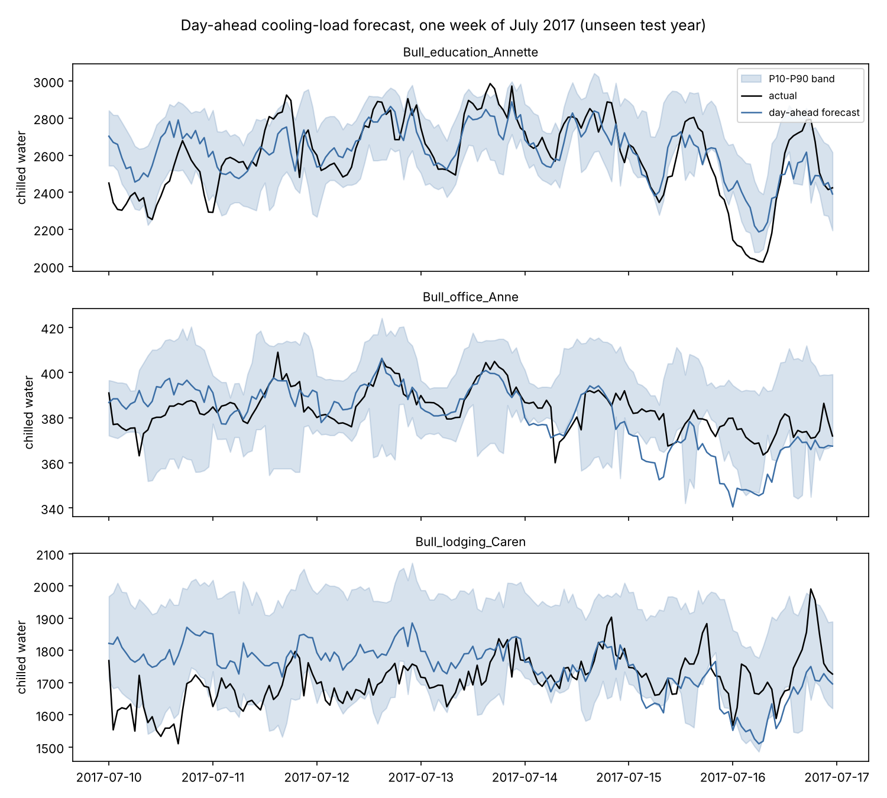
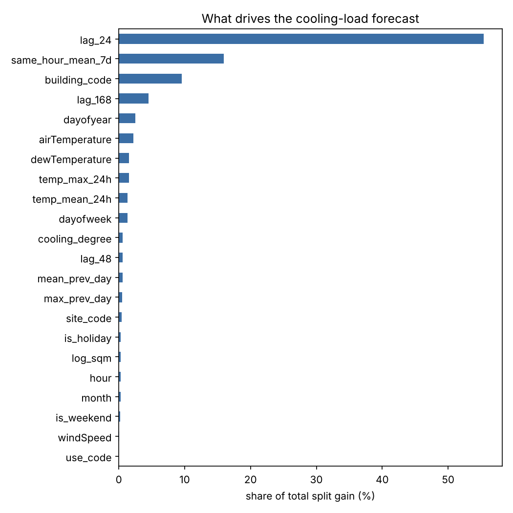
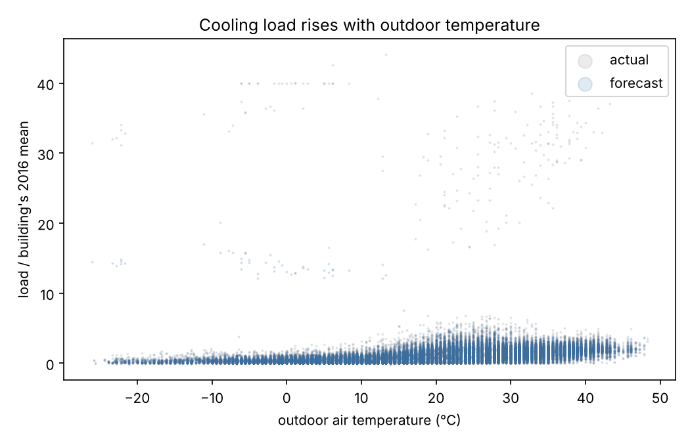
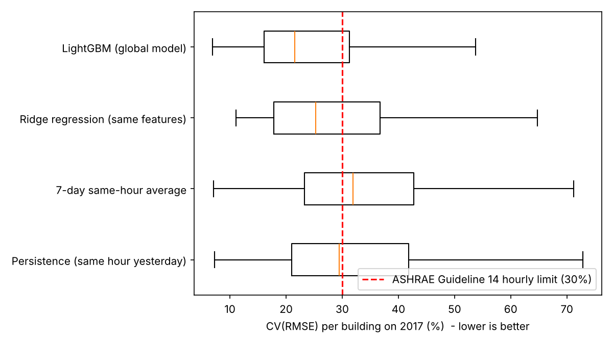

# Day-Ahead Building Cooling-Load Forecasting

Forecasting tomorrow's **hourly chilled-water (cooling) load** for **216 real buildings** with one global
LightGBM model, evaluated on a **full unseen year** using the **ASHRAE Guideline 14** accuracy criteria.

Why it matters: a chiller plant that knows tomorrow's cooling demand can schedule chillers, pre-cool
thermal storage, and avoid expensive peak-hour electricity. Accurate load forecasts are the first step
of almost every AI-based building energy optimisation system.



## Results (test year 2017, never seen during training)

| Model | Median CV(RMSE) ↓ | Median \|NMBE\| ↓ | Peak-hour MAPE ↓ | Buildings meeting ASHRAE 14 ↑ |
|---|---|---|---|---|
| Persistence (same hour yesterday) | 29.5 % | 0.1 % | 9.9 % | 51.4 % |
| 7-day same-hour average | 31.9 % | 0.3 % | 13.0 % | 46.3 % |
| Ridge regression (same features) | 25.3 % | 4.2 % | 11.4 % | 63.0 % |
| **LightGBM (global model)** | **21.6 %** | 1.9 % | 10.2 % | **72.7 %** |

* LightGBM cuts the median error by **27 %** relative to the "same as yesterday" baseline and raises the share
  of buildings whose forecast meets the ASHRAE Guideline 14 hourly limits (CV(RMSE) < 30 %, |NMBE| < 10 %)
  from 51 % to **73 %**.
* An 80 % prediction interval (P10–P90, from two quantile LightGBM models) contains the true load
  **78.0 %** of the time, close to the intended 80 %.
* Honest limitation: on the 5 % highest-load hours of each building, persistence is about as good
  (9.9 % vs 10.2 % error). Peaks are where a weather-driven model should help most; better peak handling is
  listed under next steps.

All numbers are produced by `src/train_evaluate.py` and stored in `results/metrics.json`.

## Data

[Building Data Genome 2](https://github.com/buds-lab/building-data-genome-project-2) (Miller et al.,
*Scientific Data*, 2020): hourly meter data for 1,636 non-residential buildings, 2016–2017.
We use the **chilled-water meters** and keep the 216 buildings with < 5 % missing and < 5 % zero readings
(education, office, lodging, assembly, public, health buildings at 5 US sites), plus each site's hourly
weather.

## Method

**Task (day-ahead).** At midnight, forecast all 24 hourly loads of the next day. Every feature built from the
load itself is therefore at least 24 hours old, so there is no information leak from the future.
Measured weather at the target hour stands in for a weather forecast (standard practice in load studies;
a real forecast would add some error).

**Features.**

* *Weather (physics of cooling):* air and dew-point temperature, wind, cooling degrees above an 18 °C balance
  point, 24-hour mean and max temperature (building thermal mass keeps yesterday's heat).
* *Calendar (occupancy):* hour, weekday, weekend, US federal holiday, month, day of year.
* *Load history:* load 24 h, 48 h and 168 h ago, previous-day mean/max, 7-day same-hour mean.
* *Building:* id, site, primary use, floor area.

**One global model for all buildings.** Each building's load is divided by its own 2016 mean, so a 300-unit
office and a 3,000-unit campus building share one scale and one model learns from all of them.

**Training / testing.** Train on 2016 (Jan–Aug fits the model, Sep–Dec picks the number of trees by early
stopping, then refit on all of 2016). Test on **all of 2017**.

**Metrics (ASHRAE Guideline 14).**

* CV(RMSE) = RMSE / mean load × 100 % (overall error size)
* NMBE = Σ(actual − predicted) / (n × mean load) × 100 % (systematic over- or under-prediction)
* Peak-hour MAPE: average % error on each building's top 5 % hours

## What the model learned

 

Recent history (yesterday's load, the 7-day profile) carries most of the signal. Temperature features then
explain the day-to-day changes; the forecast reproduces the physical rise of cooling load with outdoor
temperature.



## Run it

```bash
pip install -r requirements.txt
python src/download_data.py      # ~100 MB from the BDG2 GitHub repository
python src/train_evaluate.py     # ~2 minutes on a laptop; writes results/
```

## Project structure

```
src/download_data.py    downloads chilled-water meters, weather, building metadata
src/features.py         cleaning, building selection, feature engineering
src/train_evaluate.py   baselines, LightGBM point + quantile models, metrics, plots
results/                metrics.json, metrics_table.csv, figures
```

## Next steps

* Replace measured weather with archived weather forecasts to measure the real forecast-error cost.
* Peak-focused training (weighted loss on high-load hours) to beat persistence on peaks.
* Feed the forecast into a chiller-scheduling or pre-cooling optimiser (see the companion
  `rl-hvac-control` project).
